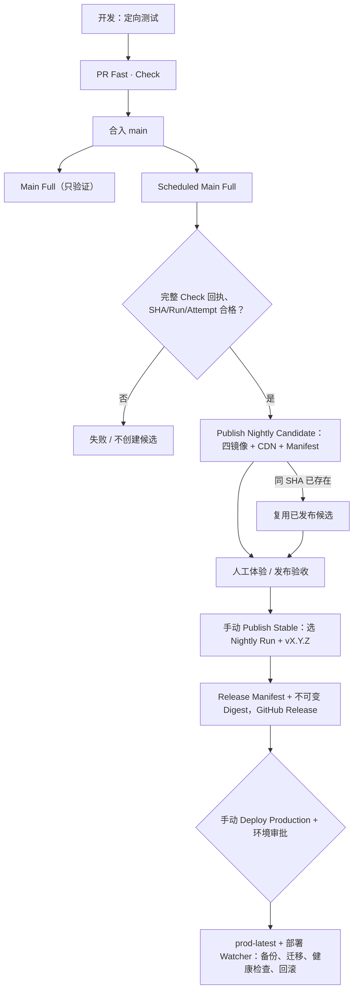

# BodySense Nightly → Stable → Production

源代码：`.github/workflows/{ci,candidate-publish,release-publish,deploy-production}.yml`。**CI、候选构建、正式版本发布、生产部署是四个不同决策**。

## 1. CI 与 Nightly

正常 `main` push 只运行验证，不创建 Candidate、不改变 `staging-latest` 或 `prod-latest`。每日 Scheduled Main Full 全选 Web、Go、AI、Contracts、PG18 恢复和 Playwright E2E。完整 `Check` 结果与回执身份一致后，`candidate-publish.yml` 才构建/复用源 SHA 的候选镜像、R2/CDN 静态资源、`candidate-set-v1.json`。同一 SHA 仅在历史 Candidate Manifest 完整、候选运行成功，且原始 CI 确认来自成功的 Scheduled Main Full 时才允许复用；普通 Push 产生的旧候选不能复用。复用时也会将验签的 Candidate Manifest 附加到本次 Nightly Run，使 Stable 可以直接选择该 Run ID。候选可在现有的 V2 显式 Staging 授权就绪后晋升 staging；Staging 晋升不是 Stable 资格的替代。

## 2. Stable 手动晋升

先人工验收 Nightly 候选和静态资源，再在 GitHub Actions 手动运行 `Publish Stable`：填写**成功的 Nightly Candidate Run ID** 与一个新版本 `release_tag=vMAJOR.MINOR.PATCH`。该工作流验证 Run 成功、source CI 为已通过的 scheduled main 全量运行、候选 Manifest SHA/Digest、主线可达性，**不重新构建镜像**，只把四个原候选 OCI Digest 提升为版本标签，生成带 `candidateRunId`、source `ciRunId`、Manifest Digest、四镜像和 CDN 身份的 `release-manifest.json`，发布 GitHub Release。

`Publish Stable` 仅在显式手动触发时执行。Nightly 完成或 Main 合并不会自动发布 Stable。既有 `Prepare Release`（release-please）可以辅助更新 CHANGELOG/版本文件，但**不是 Stable 发布授权，也不触发自动发布**。首次发布或升级仍需先核对版本号与手动 Release 的一致性。

## 3. 生产部署、恢复

生产操作仍须在 GitHub Actions 单独手动运行 `Deploy Production`，填写已正式发布的版本 Tag，经过 `production` 环境审批。部署校验 GitHub Release、不可变 Tag、Main 来源、Source CI、Nightly Candidate、Manifest 和每个镜像的 SHA/Digest；只移动 `prod-latest`，由 Alibaba 部署 Watcher 接管备份、PG18 迁移、健康和回滚。**禁止把构建成功当作生产部署成功**。

历史上已发布的旧格式 Stable 保留经校验的回滚资格；本次迁移不改密钥、数据库内容或线上部署。

## 4. 验收与状态

P5 的验收需要四步独立的真实记录：PR Fast → 合入后 Main Full → Scheduled Full 与成功的 Nightly Candidate（必须有完整 Manifest）→ 明确授权的 Stable（再按需独立 Production）。仅看到 Nightly 资格检查绿色、但候选 Job 跳过，不算构建通过。**在未人工选择版本及批准生产门禁前，不运行后两步**。

关联 GitHub [P5 #469](https://github.com/BakerSean168/BodySense/issues/469)。
